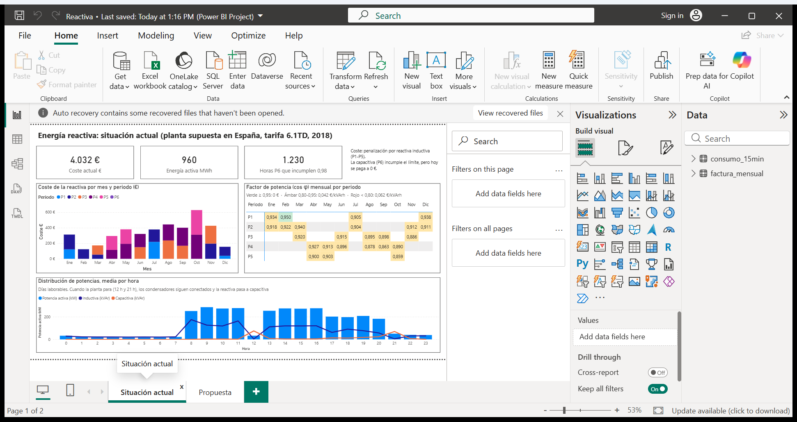
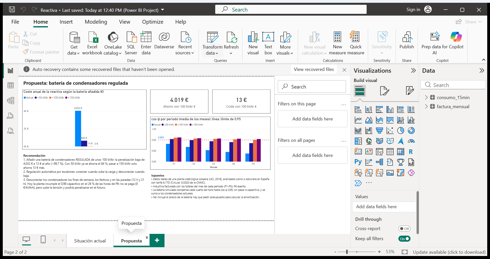

# Energía reactiva en una planta industrial: diagnóstico y propuesta

*English summary: analysis of 35,040 quarter-hourly electricity records from a steel plant (public UCI dataset), billed as if it were in Spain under the 6.1TD tariff. SQL (DuckDB) models the tariff periods and the monthly reactive-energy penalty; a simulation shows that a 100 kVAr regulated capacitor bank cuts the annual penalty from €4,032 to €13. Results are presented in a two-page Power BI dashboard.*

## La pregunta

Una planta con mucha maquinaria consume **energía reactiva**: la que necesitan motores y transformadores para crear su campo magnético. En España, si supera el 33 % de la energía activa (cos φ < 0,95), se penaliza en la factura.

> ¿Cuánto paga la planta por energía reactiva, por qué, y qué solución lo corrige?

## Los datos

- **Steel Industry Energy Consumption** ([UCI Machine Learning Repository](https://archive.ics.uci.edu/dataset/851/steel+industry+energy+consumption), licencia CC BY 4.0): consumo eléctrico real de una planta siderúrgica coreana, **un registro cada 15 minutos durante 2018** (35.040 registros): energía activa, reactiva inductiva y reactiva capacitiva.
- **Supuesto principal:** se analiza **como si la planta estuviera en España**, con la tarifa **6.1TD** (Península) y la normativa de la **Circular 3/2020 de la CNMC**.

## Normativa aplicada

| Concepto | Regla |
|---|---|
| Periodos | P1 a P6 según temporada (alta, media alta, media, baja), hora y tipo de día. Fines de semana y festivos nacionales: P6 |
| Reactiva inductiva | Se paga en P1-P5 el exceso sobre el 33 % de la activa, con los **totales del mes de cada periodo**. 0,041554 €/kVArh si 0,80 ≤ cos φ < 0,95; 0,062332 €/kVArh si cos φ < 0,80. P6 exento |
| Reactiva capacitiva | Solo en P6, hora a hora, si cos φ capacitivo < 0,98. **Precio vigente: 0 €/kVArh** |

## Cómo está hecho

```
Steel_industry_data.csv
   │  crear_tablas.sql (DuckDB)
   ├─► consumo_15min        35.040 filas: hora corregida, calendario y periodo P1-P6
   ├─► capacitiva_horaria    4.696 horas de P6: ¿se incumple el 0,98?
   ├─► simulacion_15min     reactiva que quedaría con una batería de 50, 100 o 150 kVAr
   └─► factura_mensual         36 filas (mes × periodo): factura actual y con cada batería
   │  exportar_csv.sql
   ▼
datos/*.csv  ──►  generar_powerbi.py  ──►  powerbi/Reactiva.pbip (Power BI)
```

Detalles que conviene conocer:
- **Limpieza de la hora:** en el CSV la marca de tiempo es el *final* del cuarto de hora, y el último registro de cada día lleva la fecha del día anterior (`01/01/2018 00:00` va después de `01/01/2018 23:45`). Ambas cosas se corrigen antes de asignar periodos.
- **La factura se calcula con totales mensuales, no cuarto a cuarto:** dentro de un periodo, los cuartos de hora con buen cos φ compensan los malos.
- **La simulación** supone una batería **regulada** que, en cada cuarto de hora, compensa lo que falta para llegar a cos φ 0,95 (hasta su tamaño máximo), sin llevar nunca la planta a capacitivo, y que se suma a los condensadores actuales.
- Las fórmulas de la factura están en **macros de SQL** (`cos_phi`, `exceso_ind`, `precio_ind`, `coste_ind`) y se reutilizan para la situación actual y para cada escenario.

## Resultados

**Situación actual**
- La planta paga **4.032 €/año** de reactiva inductiva. Ningún mes baja de cos φ 0,80 en P1-P5, así que todo el exceso se paga al precio bajo.
- A plena carga **falta compensación**: el cos φ mensual se queda entre 0,86 y 0,95.
- En las paradas **sobra**: a las 12 h y a las 21 h de los días laborables, y los fines de semana, los condensadores siguen conectados con los motores parados y la planta pasa a capacitiva. Se incumple el 0,98 en **1.230 de las 4.696 horas de P6 (26 %)**. Hoy no se paga, pero sube la tensión y podría penalizarse en el futuro.

**Propuesta: batería de condensadores regulada**

| Batería añadida | Coste anual | Ahorro |
|---|---|---|
| Ninguna (actual) | 4.032 € | — |
| 50 kVAr | 643 € | 3.388 € (84 %) |
| **100 kVAr** | **13 €** | **4.019 € (99,7 %)** |
| 150 kVAr | 0 € | 4.032 € |

**Recomendación:** batería **regulada por escalones de unos 100 kVAr**, y desconectar los condensadores los fines de semana, los festivos y en las paradas de producción. La amortización depende del presupuesto de la batería, que no se incluye.

## Dashboard (Power BI)





## Cómo reproducirlo

Requisitos: Python 3 con `duckdb`, y Power BI Desktop.

```bash
pip install duckdb
python -c "import duckdb; c = duckdb.connect('eficiencia.duckdb'); c.execute(open('crear_tablas.sql', encoding='utf-8').read()); c.execute(open('exportar_csv.sql', encoding='utf-8').read())"
python generar_powerbi.py
```

Después, abrir `powerbi/Reactiva.pbip` con Power BI Desktop y pulsar **Actualizar**. El parámetro `DataFolder` (en *Transformar datos*) tiene la ruta de la carpeta `datos`: si clonas el proyecto en otra ubicación, cámbialo.

En Windows, clona el proyecto en una ruta corta (por ejemplo `C:\Proyectos\`): los proyectos de Power BI tienen rutas largas y Windows limita la longitud a 260 caracteres.

## Estructura

| Archivo | Contenido |
|---|---|
| `Steel_industry_data.csv` | Datos originales (UCI) |
| `crear_tablas.sql` | Limpieza, periodos, capacitiva, simulación y factura (DuckDB) |
| `exportar_csv.sql` | Exporta las tablas que usa Power BI a `datos/` |
| `datos/` | `factura_mensual.csv` y `consumo_15min.csv` |
| `generar_powerbi.py` | Genera el proyecto de Power BI (formato PBIP: modelo TMDL e informe PBIR) |
| `powerbi/` | Proyecto de Power BI |
| `capturas/` | Capturas del dashboard |

## Autor

**Pere Puig Sallés** — Ingeniero Industrial (ETSEIB, UPC), con experiencia en auditorías de eficiencia energética.
